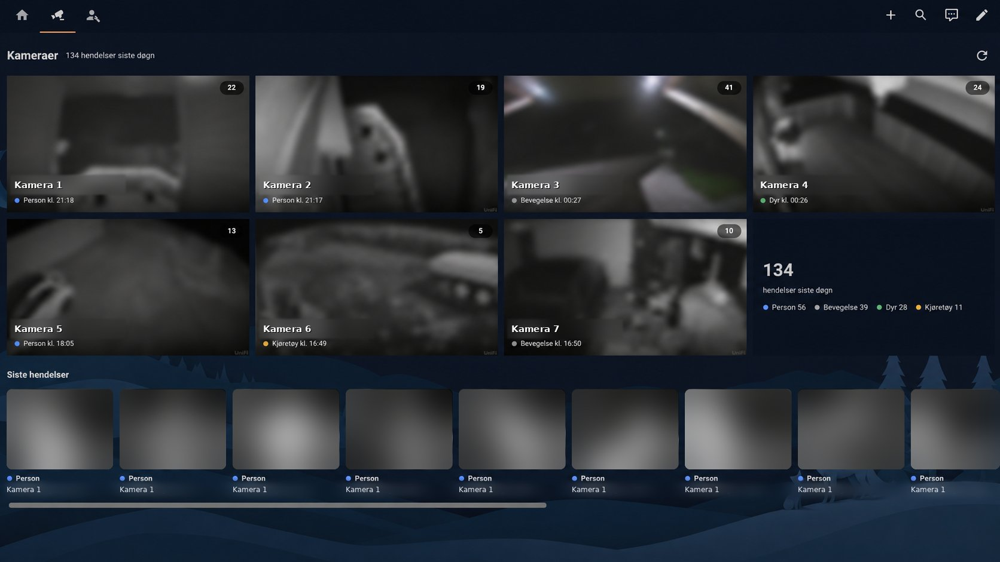

# Protect Camera Card

A Home Assistant Lovelace card for UniFi Protect cameras.



*Overview with Norwegian UI. Snapshots, camera names and the event strip are redacted for privacy.*

- **Overview:** snapshots that refresh in the background, event count for the last 24 hours per camera, and a strip with the latest events across all cameras.
- **Camera view:** high-resolution live view over WebRTC, falling back to Home Assistant's own player. Control buttons for related entities (lights, locks, sirens, scripts) and the camera's events for the last 24 hours.
- **Clips:** tap an event to play the recording in place.

Events come from the UniFi Protect integration's media source, the same source as the Media panel in Home Assistant. No extra integrations are needed.

The overview uses snapshots only. Live streaming starts only for the camera you open, which keeps the overview fast even with many cameras.

## Requirements

- Home Assistant 2024.11 or newer
- The [UniFi Protect integration](https://www.home-assistant.io/integrations/unifiprotect/)
- For fast live view: WebRTC through Home Assistant's built-in go2rtc. Without it, the card falls back to HLS, which typically takes several seconds to start.

## Installation

### HACS (custom repository)

1. HACS → three-dot menu → **Custom repositories**.
2. Add `https://github.com/trikkssitt/protect-camera-card` with type **Dashboard**.
3. Install **Protect Camera Card** and reload the browser.

### Manual

1. Copy `dist/protect-camera-card.js` to `/config/www/protect-camera-card.js`.
2. Add a dashboard resource: URL `/local/protect-camera-card.js?v=0.3.0`, type **JavaScript module**. Change `?v=` on every update so browsers fetch the new file.

## Configuration

```yaml
type: custom:protect-camera-card
cameras:
  - entity: camera.front_door_medium
    live_entity: camera.front_door_high
    controls:
      - light.front_door
      - lock.front_door
  - entity: camera.driveway_medium
  - entity: camera.garden_medium
    protect_name: Garden
```

### Card options

| Option | Default | Description |
| --- | --- | --- |
| `cameras` | required | List of cameras, see below. |
| `title` | translated "Cameras" | Card title. |
| `columns` | `4` | Columns in the overview grid. Narrow screens use 2. |
| `refresh_seconds` | `10` | Snapshot refresh interval. |
| `events_refresh_seconds` | `90` | Event refresh interval (minimum 20). |
| `event_type` | `all` | `all`, `smart`, `motion`, `ring` or `audio`. |
| `exclude` | `[audio]` | Event kinds to hide: `person`, `vehicle`, `animal`, `package`, `ring`, `motion`, `audio`, `other`. |
| `snapshot_width` | `640` | Width requested for overview snapshots. |
| `strip_limit` | `16` | Number of events in the overview strip. |
| `list_limit` | `40` | Number of events in the camera view. |
| `live_mode` | WebRTC | Set to `hls` to skip WebRTC and use Home Assistant's player directly. |
| `webrtc_ice` | `auto` | `auto` tries without ICE servers first (fast on the local network), then with Home Assistant's. `none` or `ha` forces one. |
| `webrtc_timeout` | `8` | Seconds without data before WebRTC gives up. |
| `nvr_id` | first console | Pick a console when you have several. |
| `language` | Home Assistant's language | `en` or `nb`. Other languages fall back to English. |

### Camera options

| Option | Description |
| --- | --- |
| `entity` | Camera entity for snapshots. A medium-resolution stream is usually enough. |
| `live_entity` | Camera entity for live view. Defaults to `entity`. |
| `name` | Display name. Defaults to the entity's friendly name. |
| `controls` | Entities shown as buttons in the camera view. Lights, switches, sirens and input booleans toggle; buttons are pressed; scripts and scenes run; anything else opens the more-info dialog. |
| `protect_name` | Protect camera name, when automatic matching fails. |
| `protect_id` | Protect camera ID, overrides `protect_name`. |

The card matches each entity to a Protect camera by name. If it cannot, it says so under the event strip and lists the available Protect names.

## Known limitations

- **Events depend on the integration's internal format.** The card reads event IDs and titles such as `Object Detection - person` from the UniFi Protect media source. This is not a public API. If an update changes the format, the card shows a notice instead of events. Please open an issue with your Home Assistant version.
- Only the last 24 hours of events are shown.
- On iPhone and iPad, fullscreen works on the video only, not the whole stage.

## Development

```sh
npm test    # parser and formatting tests, no dependencies
```

Releases are created from tags (`v0.3.0`). The tag must match `CARD_VERSION` in the card.

## License

MIT
